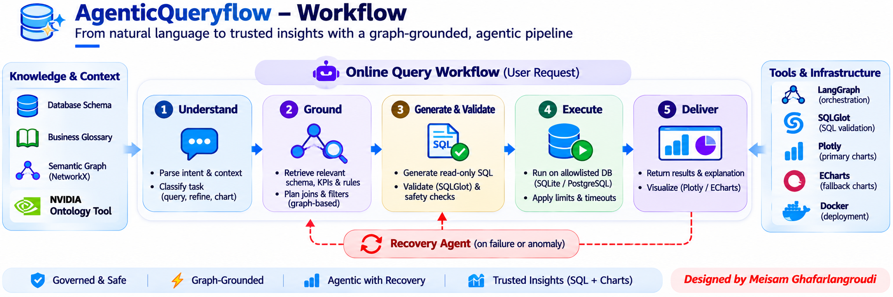
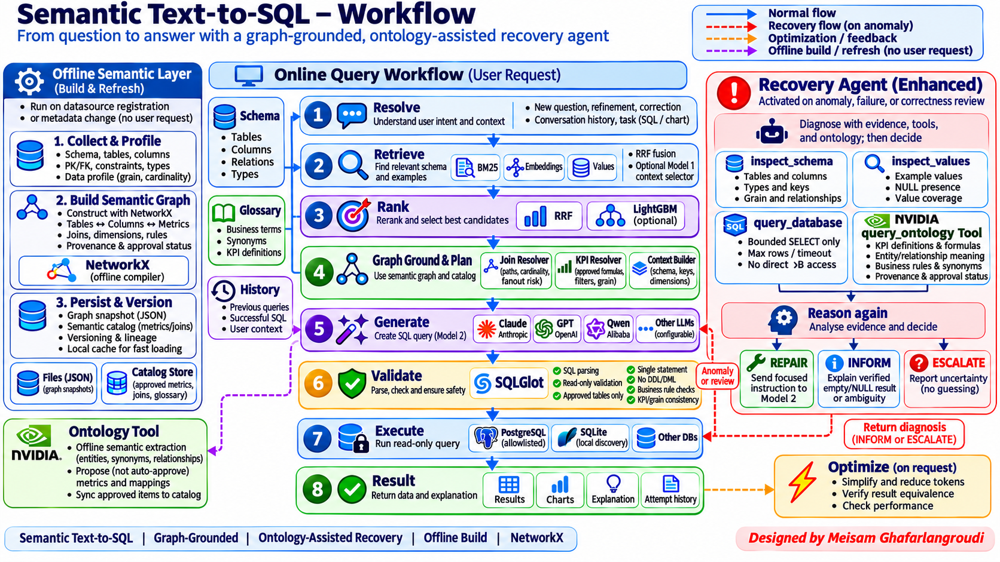

# AgenticQueryFlow

**From business questions to governed SQL, trusted data exploration, and interactive analytics.**

[AgenticQueryFlow](https://github.com/meisamgh/AgenticQueryFlow) is an open-source conversational analytics application for supported SQL data sources and analytical warehouses. Ask questions in natural language, inspect the generated read-only SQL and its results, refine analyses through follow-up conversations, and create charts or dashboards from validated data.

[**Architecture details**](docs/V6_4_PROGRESS.md) · [**Connection guide**](docs/EXTERNAL_DATABASES.md)

## Demo video

https://github.com/user-attachments/assets/cea65003-e31e-4846-a532-904ffcb6e25f

<p align="center">
  
</p>

<details>
  <summary><strong>View detailed architecture</strong></summary>
  <p align="center">
    
  </p>
</details>

## What you can do

## Features

- **Conversational analytics:** A LangGraph assistant selects tools for new queries, refinements, explanations, investigations, and charts.
- **Grounded Text-to-SQL:** Hybrid schema retrieval using BM25, embeddings, value matching, deterministic metadata verification, optional graph grounding, and SQL generation.
- **Read-only execution:** SQLGlot validation, database allowlists, row limits, timeouts, and bounded model/database calls.
- **Evidence-based recovery:** Investigates failed queries, empty results, unexpected NULLs, and explicit correctness-review requests before proposing repair or escalation.
- **Validated charts:** The Top-layer agent proposes chart encodings; a deterministic service validates accepted results and renders through Plotly with an ECharts fallback.
- **Inspectable workspace:** SQL and Data tabs, CSV export, chart exploration, query history, versions, usage details, and optional voice transcription.

- **Ask and refine questions.** A LangGraph assistant selects governed tools, maintains conversation context, and supports follow-ups, corrections, explanations, and investigations.
- **Generate grounded SQL.** Hybrid schema retrieval combines BM25, embeddings, value matching, and optional reranking with business glossary definitions and verified metadata.
- **Use governed business metrics.** An approved semantic catalog can ground formulas, dependencies, filters, and join relationships. Optional NetworkX graph grounding expands relevant relationships without another LLM call.
- **Inspect safe query execution.** SQLGlot checks, source/table allowlists, row limits, timeouts, and request budgets constrain generated queries.
- **Recover with evidence.** A bounded Recovery Agent investigates detected failures, empty results, unexpected NULLs, and explicit correctness reviews. An optional *local* ontology lookup provides approved semantic evidence; it is not an external ontology service.
- **Explore interactive charts.** Chart proposals are validated against complete accepted results. Plotly renders charts, with an ECharts fallback. Chart-only changes can reuse existing results without regenerating SQL.
- **Build dashboards conversationally.** Ask for a dashboard, refine its KPIs and visualizations, and save validated drafts in Dashboard Studio with version history and editing controls.
- **Inspect and revisit work.** View SQL, data, chart history, result versions, usage details, CSV exports, and optional voice transcription. SQL-based conversation memory can retrieve earlier accepted analytical definitions.

## How it works

```text
Conversation → Top-layer assistant → Selected tools
                                      ├─ Reuse accepted results / inspect history
                                      ├─ Retrieve schema → Ground context → Generate SQL
                                      │                   → Validate → Read-only execution
                                      └─ Top-layer chart proposal → Deterministic validation
                                                                  → Plotly / ECharts

Failures, empty results, unexpected NULLs or correctness reviews
    → Bounded recovery → Gather evidence → Repair or explain the limitation
```

- **Conversational continuity:** accepted contracts, stable result IDs and scoped history.
  [SQL-based memory](docs/SQL_MEMORY.md) retrieves analytical definitions on demand;
  refreshed data is distinguished from original historical snapshots.
- **Compact context:** hybrid retrieval and deterministic metadata verification; no context LLM.
  Optional [offline graph grounding](docs/SEMANTIC_GRAPH.md) adds approved KPI
  dependencies and bounded, provenance-aware join paths without extra LLM calls.
- **Governed execution:** SQLGlot checks, allowlisted data access and bounded repair.
- **Interactive results:** Visualization, Data and SQL views; charts reuse sufficient results.
- **Traceability:** tool observations, validation attempts, timings and token accounting.

**Conversational dashboards:** ask “Build a sales performance dashboard.” The
existing Top-layer agent reuses accepted evidence, retrieves missing analyses
through governed SQL, and invokes the bounded dashboard designer. Widgets keep
their own source IDs, scopes and grain. Validated designs render immediately,
without a proposal-confirmation step, creation button or mode selection.
Select a component and choose **Edit with AI**, or describe a whole-dashboard change.
Changes update the validated preview directly; Save and Publish remain separate actions.
[Autonomous workflow](docs/AUTONOMOUS_DASHBOARDS.md) · [Limits](docs/AGENTIC_DASHBOARDS.md).

Design follows verified **filters → KPIs → complementary plots**, with bounded
statistical evidence and source-preserving conversational edits.
[Designer details](docs/INTELLIGENT_DASHBOARD_DESIGN.md).

**Dashboard Studio:** save private drafts, collaborate on design, explicitly
approve versions, and reopen saved snapshots from the Library after restart—no
SQL rerun or model call. Includes version history, undo and conflict-safe saves.
External sharing remains disabled. [Setup and security](docs/DASHBOARD_STUDIO.md).

## Run locally

Requires Python 3.12+ and [uv](https://docs.astral.sh/uv/).
Business question
      |
      v
LangGraph assistant (intent, context, tool selection)
      |
      +-- Existing result? --------> Reuse accepted evidence
      |
      +-- New analysis? -----------> Hybrid retrieval
      |                                  |
      |                             Semantic grounding
      |                             (glossary, approved metrics,
      |                              optional graph join resolver)
      |                                  |
      |                             SQL generation
      |                                  |
      |                             SQLGlot + semantic checks
      |                                  |
      |                             Bounded read-only execution
      |                                  |
      +------------------------------> Accepted result
                                           |
                             +-------------+-------------+
                             |                           |
                       Answer / Data              Chart / Dashboard
                             |                           |
                             +---- Inspect / refine -----+

On detected failures or explicit review:
Recovery Agent -> evidence tools -> REPAIR / INFORM / ESCALATE
```

The assistant never treats a successful SQL execution as proof that a business definition is correct. Chart and dashboard outputs must be grounded in actual accepted results; missing measures, filters, or dimensions may require another governed query.

## Architecture highlights

**One conversational orchestrator.** The Top-Layer LangGraph assistant delegates SQL generation, result inspection, charting, and dashboard operations to bounded tools. Specialized validation stays outside the LLM.

**Hybrid retrieval with optional graph grounding.** The existing retriever supplies schema candidates. A deterministic NetworkX layer can add permitted join paths and approved KPI dependencies from versioned metadata. Graph grounding is disabled by default until evaluated on the target workload. The semantic catalog—not the derived graph—is authoritative for approved metrics.

**Evidence-based recovery.** The existing Recovery Agent uses schema inspection, value inspection, and bounded diagnostic queries. A feature-gated `query_ontology` tool can consult compatible local catalog/graph facts. No external NVIDIA ontology integration is enabled by default.

**Result-aware visualization.** The assistant can propose chart encodings; the plotting service validates them against accepted columns, rows, completeness, and result identity. A dedicated plotting-model fallback may still be used for unresolved chart proposals.

See [graph design and limitations](docs/SEMANTIC_GRAPH.md), [Phase 0 evaluation](docs/SEMANTIC_GRAPH_PHASE0.md), [dashboard workflow](docs/AUTONOMOUS_DASHBOARDS.md), and [Dashboard Studio](docs/DASHBOARD_STUDIO.md).

## Quick start

Requires **Python 3.12+** and [uv](https://docs.astral.sh/uv/).

```bash
git clone https://github.com/meisamgh/AgenticQueryFlow.git
cd AgenticQueryFlow
uv sync --dev
cp .env.example .env
```

Configure a supported data source, its allowlist and your chosen model provider in `.env`. For a small local demo, you can generate the included sample data:

```bash
uv run python scripts/create_demo_db.py --root data
```

Select the resulting data-source ID using `TEXT2SQL_DEFAULT_DB_ID`, then start the application:

```bash
uv run uvicorn semantic_text2sql.api:app --host 127.0.0.1 --port 8001 --env-file .env
```

Open [http://127.0.0.1:8001](http://127.0.0.1:8001). Available API documentation is at [`/docs`](http://127.0.0.1:8001/docs).

For other supported connectors, optional drivers, access restrictions, and setup examples, see the [data-source connection guide](docs/EXTERNAL_DATABASES.md).

## Configuration

The [`.env.example`](.env.example) file documents all available settings. Common options:

| Setting | Purpose |
| --- | --- |
| `TEXT2SQL_DATABASE_ROOT`, `TEXT2SQL_DEFAULT_DB_ID` | SQLite directory and selected database |
| `TEXT2SQL_POSTGRES_DATABASES` | PostgreSQL connection allowlist |
| `TEXT2SQL_EXTERNAL_CONNECTIONS` | Optional remote database definitions |
| `TEXT2SQL_PROFILE_ROOT` | Stored schema and column profiles |
| `TEXT2SQL_GLOSSARY_ROOT` | Approved business glossary JSON files |
| `TEXT2SQL_ASSISTANT_*`, `TEXT2SQL_SQL_*` | Top-layer conversation/chart planning and SQL generation |

Set the selected adapter's API key and base URL using [.env.example](.env.example).
Never commit `.env` or credentials. Profiles and glossary files supplement—not
replace—the database connection.

Context selection and chart materialization make no independent model calls.
The Top layer plans charts; invalid or missing proposals use deterministic
validation and fallback. Conditional recovery and the dashboard designer remain.
[Architecture changes and measured results](docs/SINGLE_PLANNER.md).

[Current V6.4 implementation status](docs/V6_4_CURRENT_REPORT.md) covers semantic
proofs, bounded graph ambiguity, approved KPI grounding and recovery auditability.

**Databases:** SQLite, PostgreSQL, plus optional MySQL, SQL Server, Snowflake and
BigQuery adapters. See [connection setup](docs/EXTERNAL_DATABASES.md) for driver
extras, read-only permissions, BigQuery cost ceilings and profiling. SQL Server
also requires a system ODBC driver.
| `TEXT2SQL_DEFAULT_DB_ID` | Select the configured data source |
| `TEXT2SQL_EXTERNAL_CONNECTIONS` | Register additional supported connections |
| `TEXT2SQL_SQL_PROVIDER` / `TEXT2SQL_SQL_MODEL` | Configure the SQL-generation model |
| `TEXT2SQL_CONVERSATIONAL_AGENT_ENABLED` | Enable the conversational agent |
| `TEXT2SQL_CONTEXT_MODE` | Use retrieval or optional model-based context planning |
| `TEXT2SQL_GLOSSARY_ROOT` / `TEXT2SQL_SEMANTIC_CATALOG_ROOT` | Load business definitions and approved semantic facts |
| `TEXT2SQL_GRAPH_ENABLED` | Enable optional graph grounding (default: off) |
| `TEXT2SQL_ONTOLOGY_RECOVERY_ENABLED` | Enable optional local ontology evidence during recovery (default: off) |
| `TEXT2SQL_DASHBOARD_LOCAL_WORKSPACE` | Configure the local dashboard workspace |

Keep credentials, local `.env` files, data files, and generated snapshots out of version control. Do not send secrets to models.

## Verification

```bash
uv run pytest -q
uv run ruff check src tests
uv run mypy src
deno test -A tests/*.cjs
git diff --check
```

These checks cover software behavior, including scripted integrations. They **do not** establish live connectivity, end-to-end business-semantic correctness, or production readiness. Graph-on accuracy, independent business-rule validation, and external ontology integration still require further evaluation.

## Project status and documentation

AgenticQueryFlow is intended for **controlled analytics pilots** with reviewed business definitions and governed access. Shared or public deployment requires production-grade identity, session ownership, authorization, and operational controls. External dashboard sharing is not enabled.

- [Implementation status and remaining requirements](docs/V6_4_PROGRESS.md)
- [V6.4 acceptance matrix](docs/V6_4_MATRIX.md)
- [Data-source setup](docs/EXTERNAL_DATABASES.md)
- [Offline semantic graph](docs/SEMANTIC_GRAPH.md)
- [Graph evaluation and known limitations](docs/SEMANTIC_GRAPH_PHASE0.md)
- [Dashboard architecture](docs/AUTONOMOUS_DASHBOARDS.md)
- [Dashboard Studio](docs/DASHBOARD_STUDIO.md)
- [Performance notes](docs/PERFORMANCE.md)
